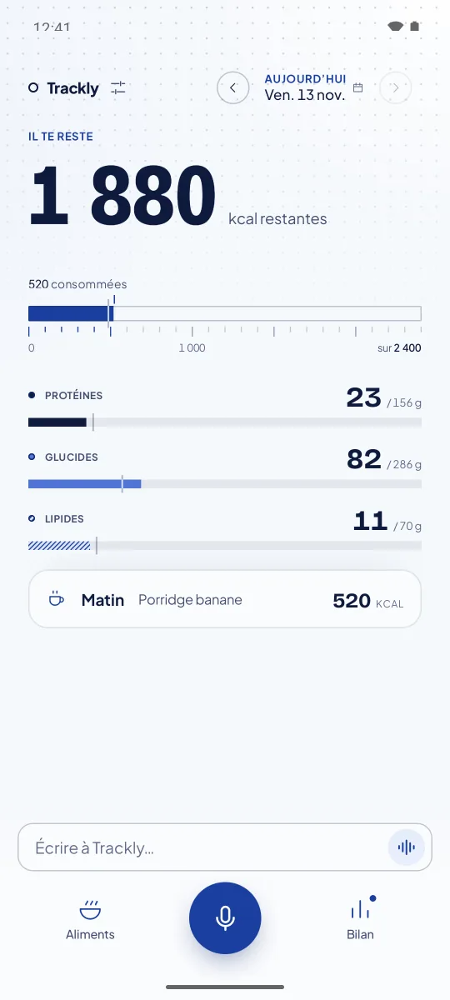
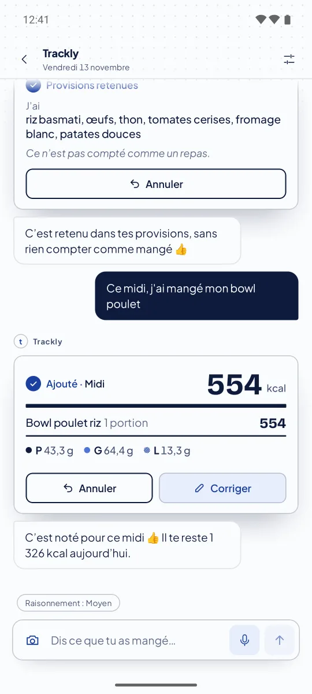
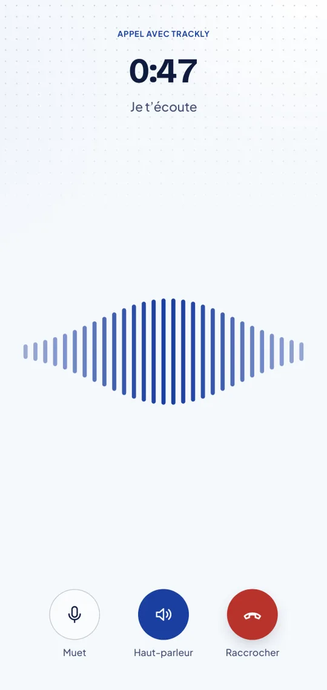
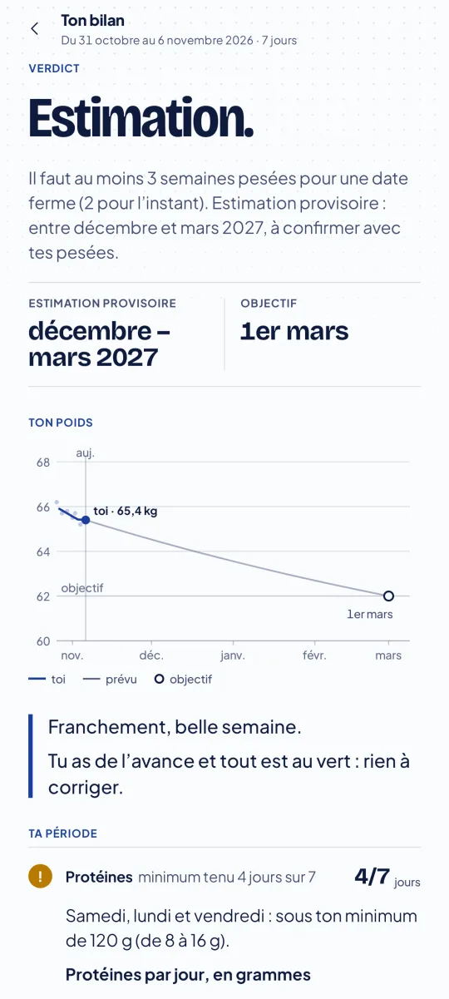

# Trackly

**Say what you ate. Trackly does the math.**

Trackly is an open-source Android food log with an AI assistant. You type a line, dictate, snap a photo of a
plate or a nutrition label, or start a short voice call. The assistant works through tools that the app runs
(look up your products, record an entry, search the web), and **every number you see is computed by the app**
from your entries, never by the model. Your journal is stored on your phone.

Website: <https://enzotrp974.github.io/trackly-android/>

<p>
  
  
  
  
</p>

Screenshots come from an emulator with a made-up profile and journal.

> **Not medical advice.** Trackly estimates food energy and nutrients to help you keep a journal. Numbers can be
> wrong. It does not diagnose, treat or prevent any condition. Talk to a health professional before changing your
> diet, especially if you are pregnant, have an eating disorder, diabetes or another medical condition.

> **Language.** The app's interface and the assistant's instructions are in French today. English is planned;
> contributions are welcome.

## Features

- **Chat assistant** (OpenAI Responses API, GPT-6.1 Sol or Terra): describe a meal in your own words; the
  assistant records it through a tool call and shows a card with what was written. Every entry can be undone in
  one tap; corrections create a new version instead of overwriting history.
- **You stay in control**: only what you say you ate is logged. Meal *suggestions* wait for your tap on
  « Noter » (Log). Calories, macros, what is left today and goals are computed by the app's rules engine.
- **Live dictation** (`gpt-live-transcribe`), or transcription after you stop (`gpt-transcribe`).
- **Photos** of a plate or a label (estimate with its assumptions shown). Photos are not kept by the app.
- **Web search** for unknown branded products, with sources.
- **Voice call** (`gpt-live-1` over WebRTC): describe your meal hands-free; a reasoning model reviews the call and
  logs the meals.
- **Products and dishes** you eat often, with shortcuts and variants.
- **Dated goals** (calories, protein, fat, carbs, fibre), a day screen, and a **weekly review** page.
- **Cost estimate**: pick the model and reasoning level; see an estimate of the month's API spend.
- **Backup**: export a file, or turn on automatic backup to your own Google Drive (off by default).

## Bring your own OpenAI key

Trackly has no server and no account. Today the AI runs on **your own OpenAI API key**:

1. Create a key at <https://platform.openai.com/api-keys> (a project key with a spending limit is a good idea).
2. In the app: Réglages › Modèle et dictée › Clé OpenAI, paste the key (or scan it as a QR code).

You pay OpenAI directly for what you use. *Sign in with ChatGPT* and an optional subscription are planned; they
are not available yet.

## Privacy

- **On your phone**: journal, goals, products, dishes, chat history, reviews (app-private storage). The API key is
  encrypted with the Android Keystore.
- **Sent to OpenAI**: each AI request, i.e. your message or photo plus the context the assistant needs for that
  turn (for example today's entries and goals), sent with your key under your OpenAI account's terms.
- **Your Google Drive, only if you turn it on**: a copy of the database in a folder the app creates, using the
  `drive.file` scope.
- No analytics, ads or trackers.

## Build

Requirements:

- JDK 17
- Android SDK with platform 37 (set `ANDROID_HOME`, or `sdk.dir=...` in `local.properties`, which is git-ignored)

Everything else (Gradle 9.8, AGP 9.5, Kotlin 2.4, Compose) comes from the Gradle wrapper and `gradle/libs.versions.toml`.

```sh
./gradlew :core:test                  # rules engine (pure JVM)
./gradlew :app:testDebugUnitTest      # app: Room, migrations, screens (JVM + Robolectric), no emulator needed
./gradlew :app:verifyRoborazziDebug   # compare screens with the reference screenshots
./gradlew :app:recordRoborazziDebug   # re-record reference screenshots after an intended UI change
./gradlew assembleDebug               # debug APK: app/build/outputs/apk/debug/app-debug.apk
```

Notes:

- The APK only includes the `arm64-v8a` native libraries (WebRTC), which covers current phones and Apple-silicon
  emulators. Remove the `abiFilters` line in `app/build.gradle.kts` for x86_64 emulators.
- Tests fix the time zone to `Europe/Zurich` (a zone with daylight saving time) so they are reproducible; the app
  itself uses the phone's time zone.
- **Release builds** must be signed with your own key. Put a `keystore.properties` file (`storeFile`,
  `storePassword`, `keyAlias`, `keyPassword`) at `~/.trackly/keystore.properties` or point
  `TRACKLY_KEYSTORE_PROPERTIES` at it. Without it, `assembleRelease` stops with an explicit error.
- **Google Drive backup** needs your own OAuth client: create a Google Cloud project, enable the Drive API,
  configure the consent screen, and create an *Android* OAuth client for package `app.trackly` with the SHA-1 of
  the key that signs your APK. No client ID is stored in the code.
- **Live checks** against the real OpenAI API are skipped by default. To run them (this costs money):
  `TRACKLY_LIVE_OPENAI_KEY=... ./gradlew --no-configuration-cache :app:testDebugUnitTest --tests 'app.trackly.live.*' -PliveChecks=true`

## Architecture

Two Gradle modules:

- **`:core`**: the rules engine in pure Kotlin/JVM, no Android dependency. Versioned consumptions, tracking day
  (an entry before 5 a.m. counts for the previous day), moments of the day, dated goals, day summaries recomputed
  from active entries, typed actions with undo, weekly review figures.
- **`:app`**: the Android app. Room storage (implements the engine's storage port), Jetpack Compose screens, a
  hand-written OpenAI Responses API client (OkHttp + kotlinx.serialization, no SDK), the assistant's tools and
  instructions, dictation, voice call (WebRTC), backup (WorkManager + Drive REST), weekly review.

```text
core/src/main/kotlin/app/trackly/core/
  model/ time/ catalog/ summary/ goal/ review/ action/ store/ engine/
app/src/main/kotlin/app/trackly/
  assistant/   Responses API client, tools, prompt sections, context, turns, API key
  call/        voice call: controller, live transport, call review
  dictation/   live and file transcription
  storage/     Room entities, DAOs, migrations
  backup/      database copy, Drive client, scheduled backup, restore
  review/      weekly review page, reports, reminders
  ui/          Compose screens and theme tokens
app/schemas/   exported Room schemas (base of the migration tests)
fixtures/      synthetic parity fixture shared by engine tests
site/          the website (GitHub Pages)
```

## Contributing

See [CONTRIBUTING.md](CONTRIBUTING.md). Security issues: see [SECURITY.md](SECURITY.md).

## License

Trackly is free software under the [GNU Affero General Public License v3.0](LICENSE).
Bundled fonts (Bricolage Grotesque, Plus Jakarta Sans) are under the SIL Open Font License 1.1.

Trackly is an independent project, not affiliated with or endorsed by OpenAI. OpenAI, ChatGPT and GPT are
trademarks of OpenAI.
